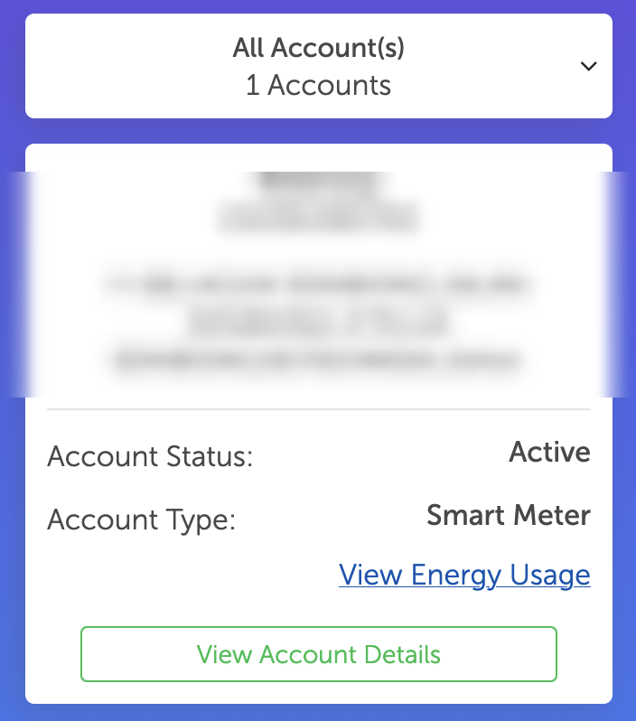
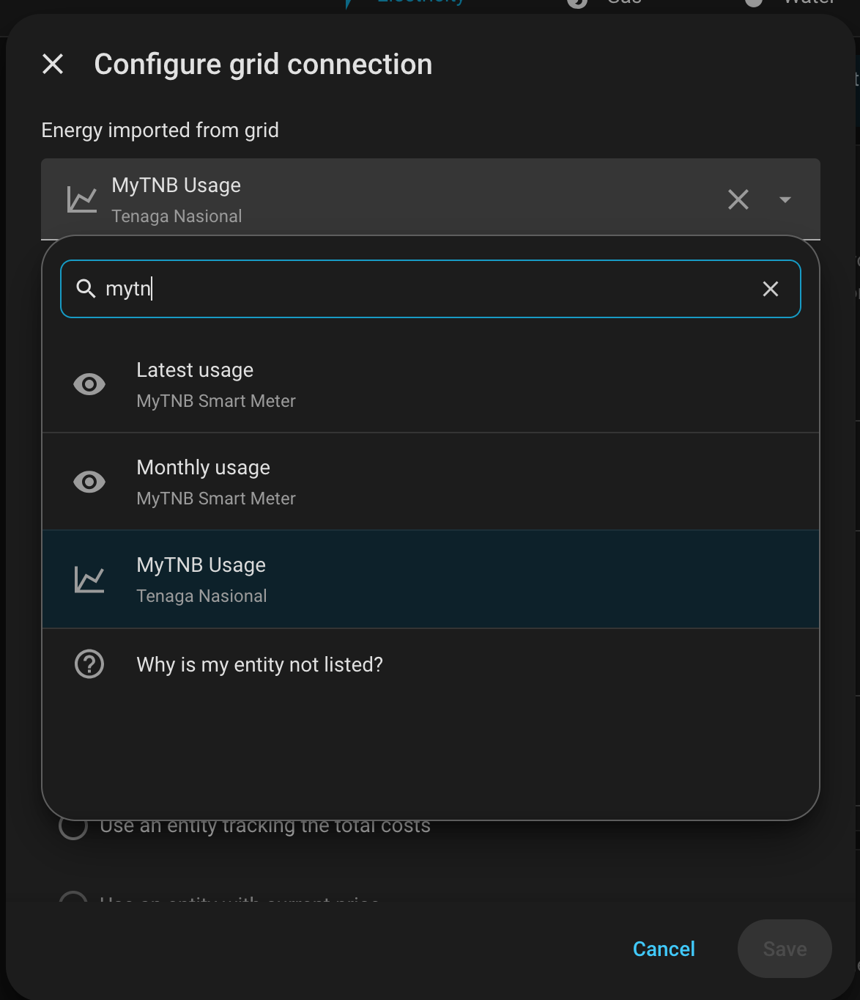
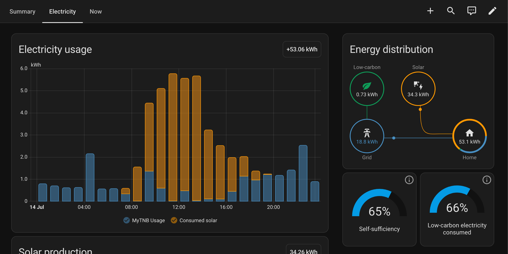
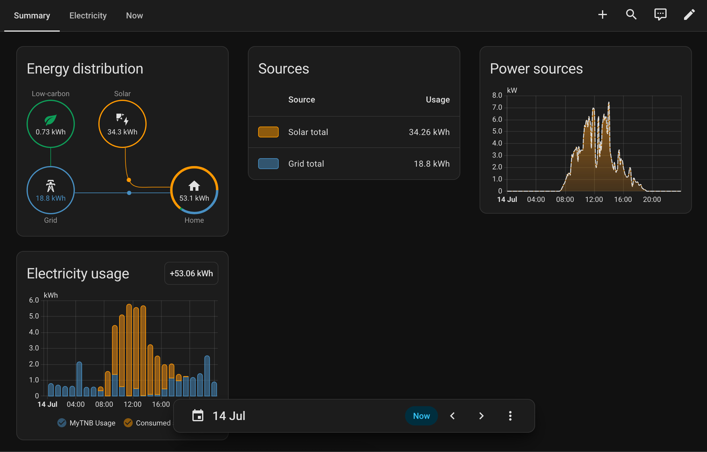

# MyTNB for Home Assistant

Custom integration for [Tenaga Nasional Berhad](https://www.mytnb.com.my/) smart meters.
It logs into the myTNB portal, reads 30-minute usage and daily cost data from the
smartliving dashboard, and feeds it into Home Assistant.

## Features

- **Sensors**: latest usage (kWh), latest cost (MYR), month-to-date usage and cost.
- **Latest bill**: the most recent bill PDF is downloaded on a schedule you
  choose (monthly, on the 1st by default; see [Options](#options)), read, and
  discarded (nothing is stored). Sensors from it:

  | Sensor | On the bill |
  | --- | --- |
  | NEM balance (kWh) | Baki NEM |
  | NEM balance expiry (date) | Tarikh Luput |
  | Previous balance (MYR) | Baki Terdahulu |
  | Current NEM charge (MYR) | Caj Semasa NEM |
  | Rounding adjustment (MYR) | Pelarasan Penggenapan |
  | Accumulated NEM balance (MYR) | Baki NEM Terkumpul |
  | NEM balance carried forward (MYR) | Baki NEM Dibawa Ke Hadapan |
  | Meter import / export reading (kWh) | Bacaan Meter, Semasa — `(I)` / `(E)` rows |
  | Billed import / export (kWh) | Penggunaan Unit — `(I)` / `(E)` rows |
  | Maximum demand (kW) | Penggunaan Unit — kW row |

  The meter readings are cumulative totals, so they can be used as grid
  consumption / return-to-grid sources in the Energy dashboard (updated once
  per bill).
- **Energy dashboard**: hourly usage and cost are imported as external long-term
  statistics (`mytnb:usage_<meter>` / `mytnb:cost_<meter>`), correctly backdated —
  TNB publishes data roughly two days late, and the statistics are recorded at
  the time the energy was actually used.
- **Reauthentication flow**: if your password changes, Home Assistant prompts for
  the new one instead of failing silently.

## Installation

### HACS

[](https://my.home-assistant.io/redirect/hacs_repository/?owner=feiming&repository=homeassistant-MyTNB&category=integration)

OR 

1. HACS → Integrations → ⋮ → Custom repositories → add
   `https://github.com/feiming/homeassistant-MyTNB` as an **Integration**.
2. Search for "MyTNB" in HACS and install it.
3. Restart Home Assistant.

### Manual

1. Copy `custom_components/mytnb` into your Home Assistant `custom_components`
   directory.
2. Restart Home Assistant.

Then add the **Tenaga Nasional** integration via *Settings → Devices & Services*.

## Configuration

You will need:

- Your myTNB **email** and **password**.
- The **smart meter URL**: log into <https://myaccount.mytnb.com.my>, go to your
  account list, and look for **View Energy Usage** on the account with **Account
  Type: Smart Meter**. Copy the full URL — it contains
  `/AccountManagement/SmartMeter/Index/TRIL?caNo=...`.

  

The account must have a TNB **smart meter**; setup reports "MyTNB lists no smart
meter for this account" otherwise.

> **Malaysian IP required.** myTNB blocks requests from non-Malaysian IP
> addresses. If Home Assistant reaches the internet through a VPN, proxy, or a
> host outside Malaysia, updates fail with errors like *"MyTNB session rejected,
> will retry"*. Check from the HA Terminal add-on with
> `curl -s ipinfo.io/country` — it should print `MY`.

### Options

After setup, **Settings → Devices & services → Tenaga Nasional → Configure**:

| Option | Default | |
| --- | --- | --- |
| Polling interval (hours) | 6 | How often smart meter usage and cost are fetched. |
| Fetch latest bill | on | Turn off to stop downloading bills; the bill sensors are removed. |
| Bill check day of the month | 1 | From this day, checks daily until the new bill (dated up to 7 days before it) is in, then waits for next month. Days past a month's end (e.g. 31) fall on its last day. |
| Bill check time | 09:00 | Malaysia time. Skipped during TNB's nightly maintenance (23:25–00:35). |

The bill is also fetched once when Home Assistant starts. A bill is recognised
by its bill date, so the same bill isn't fetched again and a late bill is still
picked up the day it appears. A failed fetch keeps the previous bill's values
and is retried on the next poll.

## Energy dashboard setup

In *Settings → Dashboards → Energy*, add **Grid consumption** and pick the
`MyTNB Usage` statistic; use `MyTNB Cost` for "Use an entity tracking the total costs".



Once configured, hourly usage shows up alongside your other energy sources:




## How it works (and why it looks odd)

The TNB portal has no public API, so the integration replays the browser flow:
login → SSO handler → smart meter page → smartliving dashboard → commodity page
→ timeseries API. Two quirks are handled internally:

- The timeseries endpoint only answers a request made right after the matching
  commodity page was loaded; otherwise it replies with a redirect-to-login JSON
  even when the session is valid.
- Fresh sessions take a few seconds to propagate on TNB's side, so login-redirect
  responses are retried before the session is considered expired.

The bill comes from the myaccount dashboard instead: its "View Bill" button
carries an encrypted account token, which `InitProtectID` exchanges for the
`billingNo` that `PrintPDF2` serves the PDF for. A failed bill download only
logs a warning and keeps the previous bill's values; smart meter data is
unaffected.

## Development

```
pip install -r requirements-test.txt
pytest
```

## License

[MIT](LICENSE)
